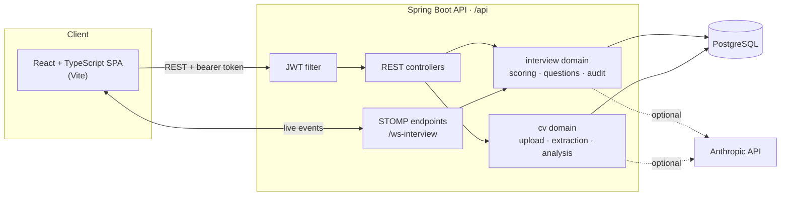

# DevInsight

[](https://github.com/AbiyevNurlan/DevInsight/actions/workflows/ci.yml) 

A technical interview platform for running coding interviews and reviewing candidates. Companies create interviews from a question bank, and candidates submit solutions. Reviewers then see automated scoring, analytics, and LLM-assisted analysis next to their own decision.

**Stack:** Java 21 · Spring Boot 4 · Spring Security (JWT) · PostgreSQL · WebSocket/STOMP · React 18 · TypeScript · Vite · Tailwind · Jest · Playwright

---

## What it does

| Area | Details |
| --- | --- |
| **Interviews** | Interview templates, a searchable question bank, per-interview participants, submissions and results |
| **Live sessions** | WebSocket (STOMP) channel for real-time interview events |
| **Candidate review** | Auto-scoring, a reviewer decision panel, feedback, and an audit trail of evaluation events |
| **CV analysis** | PDF/DOCX upload with text extraction (PDFBox, Apache POI), followed by structured LLM analysis of skills and experience |
| **AI assistance** | Question generation, behavioural analysis, explainability, and bias checks, all called through the Anthropic API |
| **Analytics** | Hiring funnel, pass/fail ratio, per-interview statistics, leaderboards and badges |
| **Admin** | Users, companies, templates, and an audit log |

## Architecture



Key design choices:

- **Feature-oriented packages:** the `interview` and `cv` domains keep their own entities, services and DTOs, so each feature can change on its own.
- **Stateless auth:** JWT access and refresh tokens. The secret and lifetimes come from configuration.
- **AI behind services:** each LLM-backed capability is its own service class, so models and prompts can be swapped without touching controllers.

Decisions and their trade-offs are recorded as [ADRs](docs/adr/README.md). A detailed data-flow write-up for the CV analysis feature is in [docs/architecture-cv-analysis.md](docs/architecture-cv-analysis.md).

## Running locally

**Requirements:** JDK 21, Node 18+, PostgreSQL 15+

```bash
# 1. Database
createdb DevInsight2

# 2. Backend
cd devInsight-backend
# configure via environment variables (see .env.example):
# SPRING_DATASOURCE_URL / _USERNAME / _PASSWORD, JWT_SECRET, ANTHROPIC_API_KEY (optional)
./gradlew bootRun             # http://localhost:8080/api

# 3. Frontend
cd ../devInsight-frontend
npm install
npm run dev                   # http://localhost:5173
```

API documentation (Swagger UI) is at `http://localhost:8080/api/swagger-ui.html` while the backend is running.

## Tests

```bash
cd devInsight-backend  && ./gradlew test        # Spring MockMvc tests
cd devInsight-frontend && npm run test:unit     # Jest + Testing Library
cd devInsight-frontend && npm run test:e2e      # Playwright
```

## Repository layout

```
devInsight-backend/     Spring Boot service
devInsight-frontend/    React client
docs/                   architecture notes
docs/adr/               architecture decision records
docs/archive/           development notes kept for history
```
